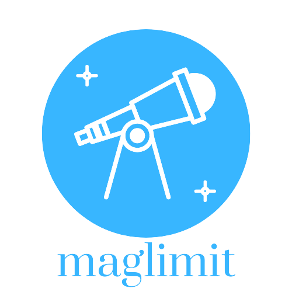

<p align="center">
   
</p>

# maglimit

[](https://semaphorep.github.io/codeastro/)

[](https://pypi.org/project/maglimit/)
[](https://zenodo.org/badge/latestdoi/506751105)
[](https://github.com/iamstarstuff/maglimit/actions/workflows/ci.yml)
[](https://maglimit.readthedocs.io/en/latest/?badge=latest)

A package to determine observability of an astronomical object using its magnitude and telescope's limiting magnitude.
As a rule of thumb, the limiting magnitude of a telescope depends on the aperture of mirror / lens:


$$L_{mag} = 2 + 5\log{D_0}$$
Where $D_0$ is the aperture in mm. `lim_mag()` uses this formula and ignores the sky; `sky_lim_mag()` also takes sky brightness and the eyepiece into account. `sky_lim_mag()` is a simplified estimate that hasn't been calibrated against real observations yet, and eyes vary, so treat its result as a guide. With no eyepiece, it assumes low power, where the exit pupil matches your eye. It can come out above the rule of thumb, because higher magnification darkens the sky background.


## Installation

Requires Python 3.10+.

```bash
pip install maglimit
```

or, in a uv project:

```bash
uv add maglimit
```

## Quick start

```python
import maglimit as ml

scope = ml.Telescope(aperture=100, fstop=4.5)   # 100 mm f/4.5
scope.lim_mag()                                  # 12.0
scope.magnification(f_eyepiece=25)               # 18.0
ml.is_object_observable("M31", scope.lim_mag())  # True (queries NED)
ml.smallest_scope("NGC 244", fs=4.5)             # (13.83, <Quantity 232.27 mm>, <Quantity 1045.22 mm>)

site = ml.Site(bortle=5)                         # or sqm=20.1
scope.sky_lim_mag(site)                          # 11.19, at low power
scope.sky_lim_mag(site, eyepiece=10)             # 12.46
scope.exit_pupil(25)                             # 5.56 (mm)
scope.dawes_limit()                              # 1.16 (arcseconds)
```

From the command line, for a summary of a telescope and its eyepieces:

```bash
maglimit scope --aperture 200 --fstop 5 --eyepieces 32,25,10 --bortle 5
```

Add `--json` to get the same numbers as JSON.

## Development

```bash
git clone https://github.com/iamstarstuff/maglimit
cd maglimit
uv sync --all-groups
uv run pytest                     # add -m "not network" to skip the live NED test
uv run sphinx-build -b html docs docs/_build/html
```

Releases are published to PyPI from GitHub releases via trusted publishing (see `.github/workflows/publish.yml`).

 ## Tutorials
 You can find the tutorial here: [docs/Tutorial/limiting_magnitude.ipynb](https://github.com/iamstarstuff/maglimit/blob/main/docs/Tutorial/limiting_magnitude.ipynb)


 ## Future Goals:
 - We use [astroquery.ipac.ned](https://astroquery.readthedocs.io/en/latest/ipac/ned/ned.html) catalogue to query the object by Messier and NGC name. 
    Further we plan to add cross-catalogue query feature.